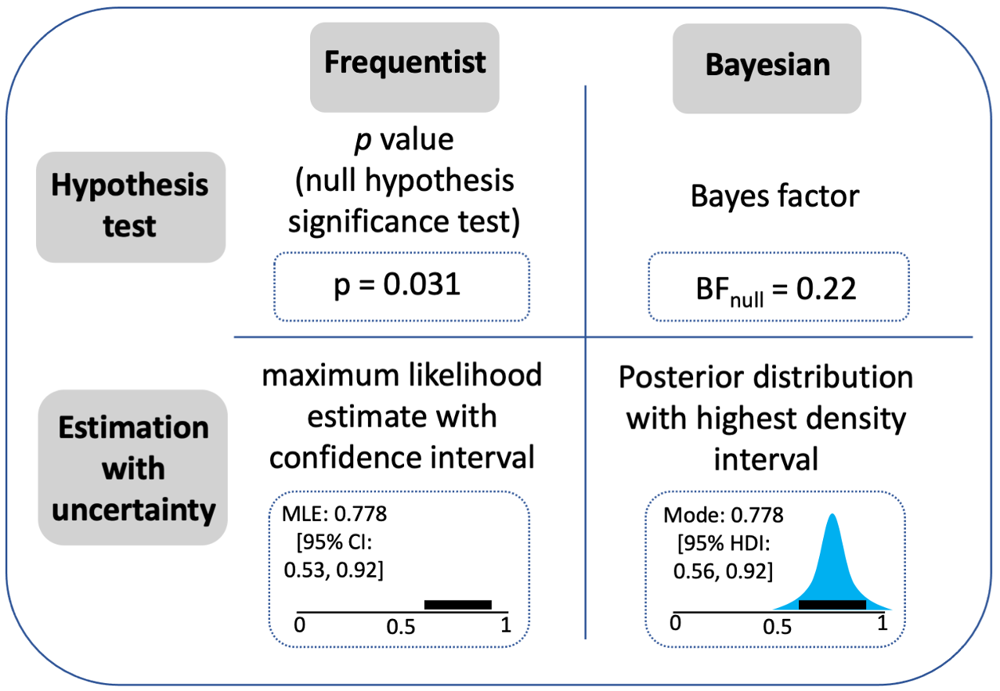

# Inferential Workflow {#sec-inferential-workflow}

::: {.callout-tip}
## tl;dr

Establish a workflow for making inferences, which is general enough that it can be used in a wide range of settings [@mcelreathStatisticalRethinkingBayesian2020; @gelmanBayesianWorkflow2026].
:::

The approach described here follows aspects of Bayesian workflows that have been outlined by several researchers [@mcelreathStatisticalRethinkingBayesian2020; @kruschkeDoingBayesianData2015; @gelmanBayesianWorkflow2020; @gelmanBayesianWorkflow2026].
We implement the approach in R using [brms](https://paulbuerkner.com/brms/) and [Stan](https://mc-stan.org/). 
Of course, this is not the only principled approach to data analysis. 
It is the one we use, and it is general enough to handle the vast majority of data structures encountered in cognitive and brain science.

A disclaimer: we do not use the entire workflow in every project (although I wish we did).
Instead, given that we find the general approach very satisfying, and we borrow from it whenever we can in combination with other tools and approaches.
In the subsections that follow, we outline key features of our preferred inferential workflow, along with some cautionary notes and examples.

## Why an inferential workflow?

The term "statistical analysis" often implies a single inferential step based on the output of a regression model or statistical test.
Instead, we try to embrace a workflow approach to inference, which involves a series of decisions about model structure, prior specification, checking, and interpretation that requires iteration and judgement at every stage [@gelmanBayesianWorkflow2020; @gelmanStatisticalWorkflow2026]. 
The distinction matters because it changes what you are trying to do.
You are not trying to produce a p-value in a ritualistic manner [@gigerenzerStatisticalRitualsReplication2018].
You are trying to build a model of the process that generated your data, check whether it is a reasonable model, and use it to update your uncertainty about the question you started with.
Fully and consistently embracing a worked-up inferential workflow remains an ambition for my group, rather than a consistent reality.
But the change in mindset from a testing strategy to a workflow fundamentally changes what you might be able to expect from a research endeavour.

## Caution first, last and always

A fancy inferential model cannot fix a broken research design or poor measurement practices.
In other words, avoid making Champagne inferences on a beer budget.
I return to this quote by Andrew Gelman, as I think it is worth repeating:

"once the data have been collected, the most important decisions have already been done".

 --- Andrew Gelman -@gelman2024before.

And I also note the cautionary conclusion to Richard McElreath's textbook on building statistical models [@mcelreathStatisticalRethinkingBayesian2020].
He makes it clear that **all** statistical models are fundamentally limited and need to be framed within the wider scientific context, such as:

:::: {.columns}
::: {.column width="50%"}
-   The importance of theory
-   Open data and materials
-   Pre-registration
-   Meta-analyses
:::

::: {.column width="50%"}
-   Computational modelling
-   Data science
-   Experimental design
-   And many more besides
:::
::::

## Estimation with uncertainty vs hypothesis testing

We follow an estimation with uncertainty approach to Bayesian regression.
Such approaches aim to quantify plausible values and their associated uncertainty in relation to a research question.
Krushcke & Liddell [@kruschkeBayesianNewStatistics2018] provide a nice comparison of the difference between estimation with uncertainty and hypothesis testing via the use of p-values or Bayes factors (@fig-kruschke).

{#fig-kruschke fig-alt="Comparison of estimation, hypothesis testing, in frequentist and Bayesian workflows."}

Importantly, both estimation and hypothesis testing approaches can be used to evaluate the evidence for or against hypotheses. 
The difference is that hypothesis tests require some form of arbitrary cut-off, which can lead to dichotomous thinking. 
In contrast, estimation approaches have no bright lines to form inferences, and instead require some evaluative thinking to summarise the sign, size and precision of the estimate in the context of the specifics of the research domain [@cummingNewStatisticsWhy2014; @frankExperimentology2025; @kruschkeBayesianNewStatistics2018; @mcelreathStatisticalRethinkingBayesian2020]. 
The additional benefit is that the outcome can remain closer to a meaningful value of interest, rather than a p-value statistic or Bayes factor.
For a longer treatment of what I like about Bayesian estimation approaches and some practical examples, see this [blog post](https://rich-ramsey.com/posts/2023-07-14_data_analysis_workflow/).

Here I just illustrate the basic idea in a few plots to give you a sense of the general approach.
Let's say you ran an experiment measuring reaction times between two experimental conditions.
You predict that condition A will lead to longer reaction times that condition B.
You calculate the contrast between two conditions and evaluate the outcome. 
Here are four possibilities based on simulated data, just to illustrate the process.

```{r}
#| label: fig-estimation-scenarios
#| fig-cap: "Four possible outcomes when estimating an effect with uncertainty. In each panel the posterior distribution summarises plausible values of the effect (e.g., a difference in reaction time between conditions, in ms). The vertical dashed line marks zero (no effect). The skyblue portion of each distribution is above zero; the grey portion is below. Inner and outer intervals show 66% and 95% quantile intervals respectively."
#| fig-width: 8
#| fig-height: 6
#| message: false
#| warning: false
#| code-fold: true
library(tidyverse)
library(ggdist)
library(patchwork)

# Fixed x-axis so zero sits in the same position across all four panels
x_lim <- c(-150, 150)

plot_posterior <- function(draws, title, subtitle) {
  tibble(effect = draws) |>
    ggplot(aes(x = effect, y = 0)) +
    # Slab: grey below zero, skyblue above zero
    stat_halfeye(
      aes(fill = after_stat(x > 0)),
      .width = c(0.66, 0.95),
      point_interval = median_qi,
      slab_colour = NA,
      interval_colour = "gray30",
      point_colour = "gray30",
      point_size = 1.5,
      height = 0.55
    ) +
    scale_fill_manual(
      values = c("FALSE" = "gray75", "TRUE" = "skyblue"),
      guide = "none"
    ) +
    geom_vline(
      xintercept = 0,
      linetype = "dashed",
      colour = "gray40",
      linewidth = 0.5
    ) +
    scale_x_continuous(limits = x_lim, breaks = seq(-150, 150, by = 50)) +
    labs(
      title = title,
      subtitle = subtitle,
      x = "Estimated effect (ms)",
      y = NULL
    ) +
    theme_minimal(base_size = 12) +
    theme(
      panel.grid.minor = element_blank(),
      panel.grid.major.y = element_blank(),
      axis.text.y = element_blank(),
      axis.ticks.y = element_blank(),
      plot.subtitle = element_text(size = 10, colour = "gray40"),
      plot.title = element_text(size = 12, face = "bold"),
      plot.margin = margin(4, 8, 4, 8)
    )
}

set.seed(1234)
n <- 4000

p_a <- plot_posterior(
  draws = rnorm(n, mean = 80, sd = 20),
  title = "A: Predicted direction",
  subtitle = "Sign and size clear; evidence supporting the hypothesis"
)

p_b <- plot_posterior(
  draws = rnorm(n, mean = 15, sd = 45),
  title = "B: Inconclusive",
  subtitle = "Sign and size unclear; evidence inconclusive"
)

p_c <- plot_posterior(
  draws = rnorm(n, mean = -70, sd = 22),
  title = "C: Opposite direction",
  subtitle = "Sign and size clear; evidence is opposite to the hypothesis"
)

p_d <- plot_posterior(
  draws = rnorm(n, mean = 4, sd = 8),
  title = "D: Precise null",
  subtitle = "Interval near zero and narrow; effect negligible in practice"
)

(p_a | p_b) /
  (p_c | p_d) +
  plot_annotation(
    caption = "Dashed line = zero. Point = posterior median. Thick interval = 66% QI; thin interval = 95% QI."
  )
```

The key point across these four scenarios is that each requires reasoning about the posterior distribution in the context of your research question.
What counts as a meaningful effect size in your domain?
How much precision do you need before acting on a finding?
These are scientific questions, not statistical ones, and they have no universal answer.
The advantage of the estimation approach is that it keeps those questions visible rather than collapsing them into a binary decision.

Note also that scenario B, which produces inconclusive evidence, is not a failure.
It provides useful information.
The data are consistent with a range of values in positive and negative directions, including both meaningful effects and negligible ones, which suggests a follow-up study with better precision is warranted.

This is where the connection to replication and multi-study approaches matters.
Rather than asking whether a result "replicated" in a binary sense, the estimation approach asks whether the new posterior, informed by more and better data, narrows the uncertainty enough to draw a clearer conclusion.
A pre-registered follow-up with an improved research design and a larger sample is not a test of whether the original finding was "real".
It is just the next step in a cumulative process of estimation, each study refining the picture.
The tools are the same throughout.
Summarise a distribution, evaluate the sign, size, and interval, and reason about what that means for the question at hand.
No arbitrary thresholds required.

## Multilevel models as a sensible default

Richard McElreath's textbook [@mcelreathStatisticalRethinkingBayesian2020] suggests that starting with the expectation that your data might be best modelled using a multi-level structure is not a bad idea.
If it turns out that a simpler, single level model is most appropriate, then that's fine.
In our experience working in cognitive psychology and neuroscience, where data typically spans repeat observations within participants and/or stimulus types, this default expectation is sensible.
We also adopt a maximal varying effects structure whenever possible, based on the suggestions by Dale Barr and colleagues [@barrRandomEffectsStructure2013].
And this is one reason why we use a Bayesian approach to building regression models because frequentist equivalents, such as those built lme4, frequently fail to converge. 
On a practical level, therefore, we are able to consistently fit fairly complex models, with the cost being that they take more time to setup and they take longer to build.

## The value of posterior predictions

Posterior predictions are predicted data values that are generated from your model.
They can be useful for at least two reasons. 
First, as part of a model checking procedure, they can be useful to check that your model can create data looks like the original data.
Second, to draw inferences, rather than interpret coefficients and model parameters, it can often be more intuitive to take complex models and make predictions in the natural scale that the observations were made in [@arel-bundockHowInterpretStatistical2024; @arel-bundockModelMeaningHow2025; @rohrerModelsPredictionMachines2026]. 
Rather than trying to directly interpret parameters in a regression model, you get values on the natural scale as a function of the research design.
This textbook by Vincent Arel-Bundock [Model to meaning](https://marginaleffects.com/) is a really helpful starting point with easy-to-use code and practical examples.
